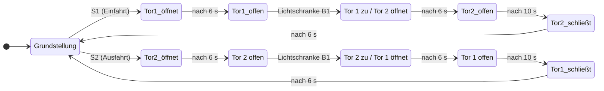

# 🚗 SmartGate-Schleuse

**Fahrzeug-Schleusenanlage mit Siemens LOGO!**

*Projekt 1 · Planung & Dokumentation*

---

## 📑 Inhalt

- [Über das Projekt](#-über-das-projekt)
- [Funktionsweise](#️-funktionsweise)
- [Ablaufdiagramm](#-ablaufdiagramm)
- [Sicherheit & Verriegelung](#-sicherheit--verriegelung)
- [Komponenten](#-komponenten)
- [Mechanik: Kreuzgewindespindel](#-mechanik-kreuzgewindespindel)
- [Projektdateien](#-projektdateien)
- [Autor](#-autor)

---

## 💡 Über das Projekt

Die **SmartGate-Schleuse** ist eine Garagen-Schleuse mit zwei Toren. Ein Fahrzeug fährt durch **Tor 1** in die Schleuse, eine **Lichtschranke** erkennt es, und erst dann schließt Tor 1, während **Tor 2** sich öffnet. Die beiden Tore sind gegenseitig verriegelt – **es sind nie beide gleichzeitig offen**.

Gesteuert wird die gesamte Anlage über eine **Siemens LOGO!**, die Motoren werden über Siemens-Sirius-Schütze geschaltet und über Motorschutzschalter abgesichert.

---

## ⚙️ Funktionsweise

### 🟢 Grundstellung
Wenn kein Not-Aus ausgelöst ist, ist die Anlage betriebsbereit. Im Ruhezustand sind **Tor 1 und Tor 2 geschlossen**.

### ➡️ Einfahrt (Taster S1)

| # | Ereignis | Reaktion |
|:-:|---|---|
| 1 | Taster **S1** wird betätigt | Tor 1 öffnet (Motor 1) |
| 2 | Motor 1 ist **6 s** gelaufen | Motor 1 stoppt – Tor 1 ist offen |
| 3 | Lichtschranke **B1** wird unterbrochen | Tor 1 schließt, **gleichzeitig** öffnet Tor 2 |
| 4 | Beide Motoren sind **6 s** gelaufen | Tor 1 zu, Tor 2 offen |
| 5 | Tor 2 ist **10 s** offen | Tor 2 schließt automatisch → Grundstellung |

### ⬅️ Ausfahrt (Taster S2)
Der Ablauf ist **spiegelbildlich**: S2 öffnet zuerst Tor 2, nach Unterbrechung von B1 schließt Tor 2 und Tor 1 öffnet. Nach 10 s schließt Tor 1 automatisch und die Anlage kehrt in die Grundstellung zurück.

---

## 🔄 Ablaufdiagramm

---

## 🛑 Sicherheit & Verriegelung

> [!IMPORTANT]
> **Not-Aus S0:** Wird S0 betätigt, werden Motor 1 und Motor 2 **sofort stillgesetzt**. Beide Tore bleiben in ihrer aktuellen Stellung, bis der Not-Aus entriegelt wird. Der Not-Aus wird direkt von der LOGO! verarbeitet.

- 🔒 **Gegenseitige Verriegelung** – Tor 1 und Tor 2 sind nie gleichzeitig offen.
- ⏳ **Keine Anforderung während des Ablaufs** – S1/S2 werden nur in der Grundstellung angenommen.
- ⚖️ **Gleichzeitiges Drücken** – werden S1 und S2 gleichzeitig betätigt, wird nur eine Anforderung verarbeitet.

---

## 🧰 Komponenten

| Bauteil | Typ / Hersteller | Technische Daten |
|---|---|---|
| Steuerung | Siemens LOGO! | – |
| Leitungsschutzschalter (LSS) | Schneider | 400 V · 2 A · C-Charakteristik |
| Motor 1 (Tor 1) | Lucas-Nülle | 400 V · 1,7 A · 0,1 kW |
| Motor 2 (Tor 2) | Siemens | 400 V · 0,41 A · 0,12 kW |
| Schütz 1 & 2 | Siemens Sirius | Steuerspannung 24 V DC · Schaltvermögen 690 V / 18 A |
| Motorschutzschalter 1 | Siemens Sirius | 1,4 – 2 A |
| Motorschutzschalter 2 | Siemens Sirius | 0,35 – 0,5 A |
| Lichtschranke B1 | Banner Mini-BEAM SM312LP | 10 – 30 V DC · 150 mA |
| Taster 1 | Siemens 3SB3400-0B | 400 V AC · 10 A |
| Taster 2 | Siemens 3SU1400-1AA10-1BA0 | 230 V AC · 6 A |
| Not-Aus-Taster S0 | Siemens 3SU1400-1AA10-1CA0 | 230 V AC · 6 A |

---

## 🔩 Mechanik: Kreuzgewindespindel

Das Garagentor fährt **hoch und runter ohne Wendeschaltung** – möglich macht das eine **Kreuzgewindespindel**: Die Spindel dreht sich immer in dieselbe Richtung, die Mutter wechselt am Ende des Gewindes automatisch die Laufrichtung.

---

## 📁 Projektdateien

| Datei | Inhalt |
|---|---|
| 📄 [`SmartGate-Schleuse-V1.pdf`](SmartGate-Schleuse-V1.pdf) | Schaltplan (EPLAN-Export) |
| 🗜️ [`Projekt1-SmartGateSchleuse.zw1`](Projekt1-SmartGateSchleuse.zw1) | EPLAN-Projektarchiv |
| 📘 [`Projektmappe.docx`](Projektmappe.docx) | Projektmappe mit Beschreibung & Bauteilliste |
| 🗂️ [`Deckblatt SmartGate Schleuse.docx`](Deckblatt%20SmartGate%20Schleuse.docx) | Deckblatt |
| 📊 [`Zeitplan Projekt 1.xlsx`](Zeitplan%20Projekt%201.xlsx) | Zeitplan |
| ✅ [`Kriterien & Punkteblatt Projekt.doc`](Kriterien%20%26%20Punkteblatt%20Projekt.doc) | Bewertungskriterien |
| 🖼️ [`Skizze/`](Skizze) | Skizzen (V1 & V2) |
| 📄 [`Beispielprojekt2.0.pdf`](Beispielprojekt2.0.pdf) | Beispielprojekt als Vorlage |

---

## 👤 Autor

**Hugo Collienne** · Klasse 4.ET · Periode 1
Bischöfliche Schule St. Vith – Technisches Institut ([bsti.be](https://www.bsti.be))
